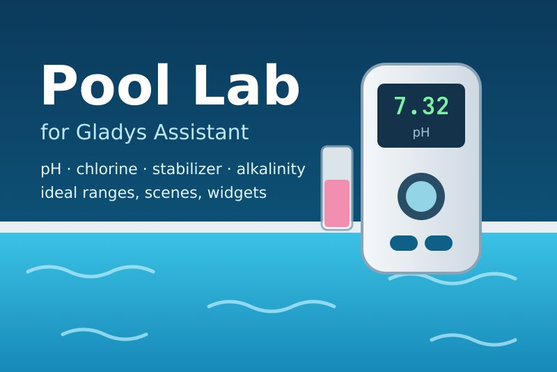
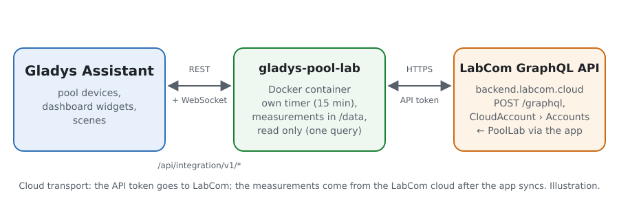
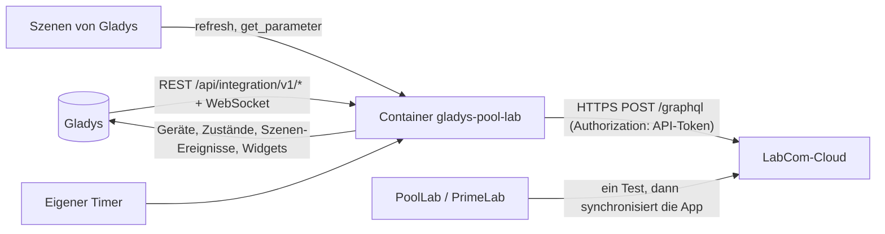
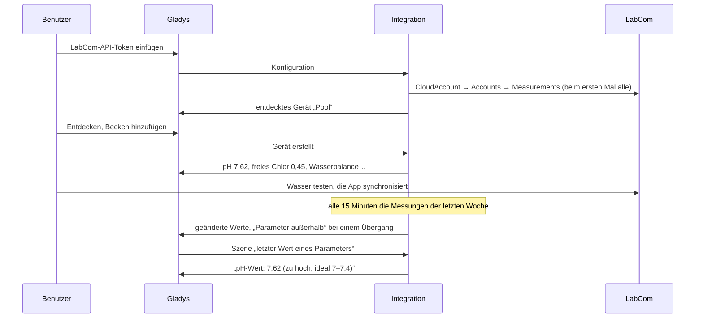
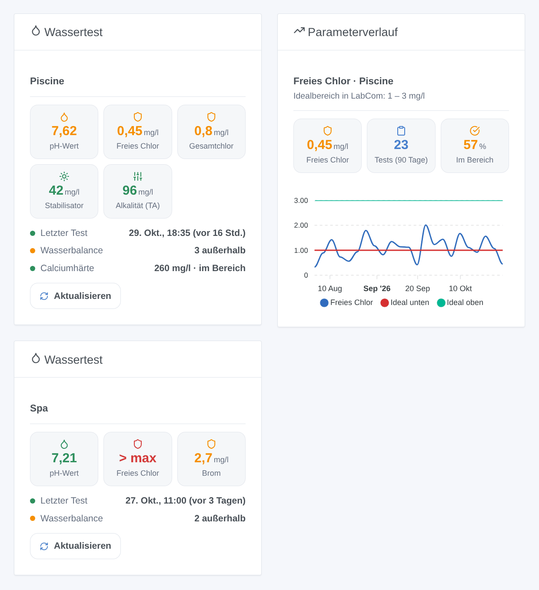

# Gladys Pool Lab

[English](README.md) · [Français](README.fr.md) · **Deutsch** · [Español](README.es.md)

[](LICENSE)
[](https://github.com/William-De71/gladys-pool-lab/releases)
[](https://github.com/William-De71/gladys-pool-lab/actions/workflows/release.yml)
[](https://gladysassistant.com)



Externe Integration für [Gladys Assistant](https://gladysassistant.com) für die Wassertester **Water-i.d. PoolLab 1.0 / 2.0 und PrimeLab**, über die offizielle API der **LabCom**-Cloud und ein persönliches API-Token. Sie zeigt in Gladys den letzten Test jedes Pools oder Spas (pH-Wert, Chlor, Stabilisator, Alkalität, Härte…) mit dem in LabCom festgelegten Idealbereich und löst Szenen aus, wenn ein Parameter seinen Bereich verlässt oder zurückkehrt oder das Wasser länger nicht getestet wurde — nur lesend.

Benutzerdokumentation: [English](docs/en.md) · [Français](docs/fr.md) · [Deutsch](docs/de.md) · [Español](docs/es.md).

Nicht mit Water-i.d. verbunden. **Nie mit einem echten LabCom-Konto getestet**: Die Abfrage folgt dem veröffentlichten GraphQL-Schema und den Feldern, die die Clients von Home Assistant und ioBroker lesen; die Ablehnung eines fehlenden Tokens (HTTP 403, eine HTML-Seite) wurde live geprüft.

## Funktionen

- Jeder **Pool oder Spa** („Messstelle“ in LabCom) des Kontos, selbst gefunden; **eine Anfrage** pro Abfrage, standardmäßig alle 15 Minuten.
- **Ein Gerät pro Becken**: eine Funktion pro gemessenem Parameter (pH-Wert, freies / Gesamt- / gebundenes Chlor, Brom, Aktivsauerstoff, Wasserstoffperoxid, Chlordioxid, Ozon, PHMB, Cyanursäure, Alkalität, Calcium- und Gesamthärte, Salz, Phosphat, Wassertemperatur, Redox und alle anderen) mit dem Wert seines letzten Tests, dazu die **Wasserbalance** (was außerhalb seines Idealbereichs liegt).
- **5 Szenen-Auslöser** (neue Messung, Parameter außerhalb, wieder im Bereich, Wassertest überfällig, Token abgelehnt), **2 Szenen-Aktionen** (jetzt aktualisieren, letzter Wert eines Parameters) und **2 Dashboard-Widgets** (letzter Test eines Beckens, Verlauf eines Parameters).
- **Nur lesend**: eine einzige GraphQL-Abfrage, nie eine Mutation; in LabCom wird nie etwas geändert.
- Die Messungen bleiben **manuell**: Die PoolLab-App synchronisiert sie mit LabCom, Gladys liest sie dort.
- Überall vier Sprachen: Englisch, Französisch, Deutsch, Spanisch.

## Funktionsweise





Vom Wassertest zur Szene:



### Transport

`transports: ["cloud"]`: Alles läuft über die LabCom-Cloud (`backend.labcom.cloud`). **Das API-Token verlässt dein Netzwerk** (nur zu LabCom); die Messungen kommen aus LabCom, wo die PoolLab-App sie ablegt. `/data/pool-lab.json` (Modus 0600) speichert einen Fingerabdruck des Tokens (nie das Token), die Becken und bis zu 300 Messungen aus 400 Tagen pro Parameter, die festgeschriebene Form jeder Funktion und was die Auslöser wissen.

## Geräte und Funktionen

| Gerät                                  | Funktionen (Kategorie / Typ)                                                                                                                                                                                                                                                     |
| -------------------------------------- | -------------------------------------------------------------------------------------------------------------------------------------------------------------------------------------------------------------------------------------------------------------------------------- |
| Eines pro Pool oder Spa mit einem Test | pH-Wert (`ph-sensor` / `decimal`), Wassertemperatur (`temperature-sensor` / `decimal`, °C), Redox (`orp-sensor` / `decimal`, mV), jeder andere Parameter (`level-sensor` / `decimal`, ppm wenn LabCom mg/l oder ppm angibt, sonst ohne Einheit), Wasserbalance (`text` / `text`) |

- Gladys hat keine Kategorie für Chlor, Brom, Stabilisator, Alkalität oder Härte: Sie verwenden den einfachen Zahlensensor `level-sensor` / `decimal`, wie die Flipr-Integration für ihr Chlor.
- Eine Funktion pro **LabCom-Parameter-ID** (`ext:pool-lab:pool:<Konto-ID>:p<Parameter-ID>`): LabCom hat eine ID pro Methode (pH-Wert per Tablette, per Flüssigkeit…), ein auf beide Arten getestetes Becken hat also zwei pH-Funktionen mit unterschiedlichen Namen.
- Kategorie, Einheit und Grenzen einer Funktion werden beim ersten Anbieten festgeschrieben (eine später in LabCom geänderte Einheit macht das „Aktualisieren“ von Entdecken nie kaputt).
- Ein Wert außerhalb des Messbereichs des Photometers (OVERRANGE / UNDERRANGE) hat keine Zahl: Die Funktion behält ihren letzten Wert; Wasserbalance, Widgets und Szenen zeigen es an.
- Unveränderte Werte werden alle 6 Stunden erneut gesendet, damit Gladys sie nicht als veraltet anzeigt (ein Becken wird ein- oder zweimal pro Woche getestet).

## Szenen-Auslöser, Aktionen und Widgets



**Widgets**: Wassertest (die ersten fünf Parameter als nach Idealbereich gefärbte Kacheln, wann der letzte Test gemacht wurde, die Wasserbalance, die anderen Parameter, eine Schaltfläche Aktualisieren) und Parameterverlauf (ein Parameter über 30, 90 oder 365 Tage zum tatsächlichen Zeitpunkt jedes Tests, unterer und oberer Idealwert als zwei Linien, Anzahl der Tests, Anteil im Bereich).

**Auslöser** (ein Ereignis pro Übergang, nie bei der ersten Abfrage, nie als Folge einer Aktion; Filter: Becken, Parameter):

- **neue Messung**: Ein Parameter hat einen neueren Test in LabCom; Variablen: Parameter, Wert, Einheit, Status, Idealbereich, Zeitpunkt, Seriennummer;
- **Parameter außerhalb** / **wieder im Bereich**: Der Status des Idealbereichs ändert sich (Filter: Richtung zu niedrig / zu hoch); Variablen: dieselben und der vorherige Status;
- **Wassertest überfällig**: keine Messung seit der eingestellten Frist (standardmäßig 7 Tage), zwischen 9 und 21 Uhr, einmal bis zum nächsten Test;
- **Token abgelehnt**: LabCom lehnt das API-Token ab — einmal pro Ablehnung.

Die Werte sind Gerätefunktionen: „freies Chlor unter 1“ ist ein Geräte-Auslöser von Gladys.

**Aktionen**:

- **jetzt aktualisieren**: liest LabCom sofort (höchstens einmal pro Minute); die Auslöser folgen in der nächsten Runde des Timers, nie aus der Aktion.
- **letzter Wert eines Parameters**: Wert, Einheit, Status, Idealbereich, Datum, vergangene Tage und ein Satz, aus der letzten Abfrage (ohne Anfrage).

Bewusst nicht umgesetzt: kein Schreiben (die API hat Mutationen, Gladys liest aber nur), keine Dosierempfehlung (die Abfrage `DosageRecommendation` braucht die Wasserpflegeprodukte des Kontos; nicht getestet), keine geteilten Messstellen.

Beispiele:

- Wenn **Pool Lab: Parameter außerhalb** (freies Chlor, zu niedrig) → „Freies Chlor {{triggerEvent.data.value_text}} mg/l: Chlor nachdosieren“ senden.
- Wenn **Pool Lab: Wassertest überfällig** → „Seit {{triggerEvent.data.days_since}} Tagen kein Pooltest“ senden.
- Wenn **Pool Lab: neue Messung** (pH-Wert) → wenn das pH-Gerät über 7,6 liegt → die pH-Minus-Dosierpumpe einschalten.

## Voraussetzungen

- Gladys Assistant **5.3.0** oder neuer (Widgets und Szenen von Integrationen, Katalog-Schlüsselwörter von Gladys 5.3): Ältere Instanzen können die Integration nicht installieren.
- Ein mit einem LabCom-Konto synchronisiertes PoolLab 1.0, PoolLab 2.0 oder PrimeLab und ein persönliches API-Token, erstellt auf [labcom.cloud/pages/user-setting](https://labcom.cloud/pages/user-setting).
- Internet: Die Integration spricht nur mit `backend.labcom.cloud`.

### Das Tempo der API

LabCom dokumentiert kein Kontingent. Die Integration bleibt sparsam: eine Anfrage nach der anderen; die erste Abfrage holt alle Messungen, danach fragt jede Abfrage die Messungen ab einer Woche vor der neuesten bekannten ab (die App kann einen Test Tage später synchronisieren), und die letzten 400 Tage alle 6 Stunden. Nach einem 429 wartet jede Anfrage auf ihr Retry-After (15 Minuten ohne Angabe).

## Installation

- **Aus dem Store**: Integrationen → Pool Lab → Installieren.
- **Über die URL des Repositorys**: Integrationen → externe Integration → `https://github.com/William-De71/gladys-pool-lab`.
- **Entwicklermodus**: `npm start` mit den von Gladys gelieferten Variablen starten (siehe Entwicklung).

## Konfiguration

| Feld oder Schaltfläche       | Standard    | Bedeutung                                                                                |
| ---------------------------- | ----------- | ---------------------------------------------------------------------------------------- |
| LabCom-API-Token             | —           | Pflichtfeld, geheim: nie wieder angezeigt, nie geloggt, nur ein Fingerabdruck in `/data` |
| Abfrage von LabCom           | 15 min      | 5, 10, 15, 30 oder 60 min                                                                |
| Test-Erinnerung nach         | 7 Tage      | 3, 7, 14 oder 30 Tage ohne Test, oder nie                                                |
| Sprache der Texte            | automatisch | Namen der Funktionen, Wasserbalance, Szenentexte und Fehler                              |
| Verbindung testen / Diagnose | —           | Liest LabCom und listet die Becken auf; der Zustand in den Logs, ohne das Token          |

## Verwendung

1. Auf labcom.cloud: Einstellungen → ein API-Token erstellen und kopieren.
2. In Gladys (Integrationen → Pool Lab → Konfiguration): das Token einfügen; **Verbindung testen** drücken.
3. **Entdecken**, dann die Becken als Geräte hinzufügen; die Widgets zu einem Dashboard hinzufügen.
4. Szenen mit den Funktionen, Auslösern und Aktionen bauen.

## Entwicklung

```bash
npm install
npm test                       # node --test, ein falsches LabCom (fetch im Speicher), nie das Netzwerk
npm run lint                   # ESLint
npm run format:check           # Prettier
npx github:GladysAssistant/integration-store . --skip-image-check
scripts/build-cover.sh         # cover.jpg aus docs/assets/cover.svg
docs/illustrations/render.sh   # docs/assets/widgets.<Sprache>.png
```

Lokal liest das SDK `GLADYS_HOST_API_URL`, `GLADYS_INTEGRATION_TOKEN` und `GLADYS_INTEGRATION_SELECTOR` (im Entwicklermodus von Gladys geliefert), und die Integration liest `TZ`. `DEBUG=gladys-integration-sdk` zeigt die Logs des SDK.

Die Tests decken den GraphQL-Client ab (das rohe Token, der HTML-403, GraphQL-Fehler, 429 und Retry-After), den Parser (Zeichenketten oder Zahlen, OVERRANGE, jede Schreibweise des Status, die „nicht festgelegt“-Regeln von LabCom), die Arten der Parameter, das Zusammenführen der Abfragen, die Auslöser (Übergänge, verspätete Messungen, Erinnerung), die Geräte (die von Entdecken verlangten Felder, die Kategorie- / Typ-Paare des SDK), die Widgets (`validateWidgetContent`), das Manifest, die vier Sprachen, das Release-Skript und die ganze Integration gegen das falsche Gladys des SDK und ein falsches LabCom mit einem erfundenen Konto (`test/fixtures/cloud.json`). `test/structure.test.js` schreibt jeden beim Benutzer gespeicherten Schlüssel fest.

## Release-Prozess


Jeder Merge auf `main` startet die CI und berechnet dann die Version aus den [Conventional Commits](https://www.conventionalcommits.org/) seit dem letzten Tag: `feat` → Minor, `fix` / `perf` → Patch, `!` oder `BREAKING CHANGE` → Major (ein Minor unter 1.0.0); `docs`, `chore`, `ci`, `test`, `style`, `refactor`, `build` allein veröffentlichen nichts. Der Changelog-Abschnitt wird erzeugt, der Tag gepusht, das Multi-Architektur-Image gebaut, dann erhält `main` den Release-Commit, das GitHub-Release wird erstellt und ein letzter Job prüft das öffentliche Image, den Validator des Stores und das Topic.

- Der Titel des Pull Requests wird zum Squash-Commit und dann zur Changelog-Zeile: Schreibe ihn auf Englisch, für den Benutzer (`pr-title.yml` prüft ihn). Bearbeite `CHANGELOG.md` nie von Hand.
- 1.0.0 ist eine Entscheidung: Actions → Release → Run workflow mit `release-as: 1.0.0`. `dry-run` zeigt Version und Notizen, ohne zu veröffentlichen.
- **Geschützter Branch**: Das Release pusht seinen Commit mit `GITHUB_TOKEN` auf `main`. Das Ruleset `protect-main` (kein Löschen, kein Force-Push) lässt ihn durch; eine strengere Regel (Pull Request Pflicht, Status-Checks) bräuchte GitHub Actions in der Bypass-Liste oder eine GitHub App.
- Mache nach dem ersten Release das Paket auf `ghcr.io` öffentlich (Package settings → Change visibility), sonst kann Gladys es nicht laden.

## Fehlerbehebung

Siehe [docs/de.md](docs/de.md#fehlerbehebung). Melde Probleme mit den Versionen von Gladys und der Integration, deinem Photometer (PoolLab 1.0, 2.0, PrimeLab), der Meldung von **Verbindung testen** und dem Ergebnis von **Diagnose** (in den Logs der Integration). Füge nie dein Token ein.

## Mitwirken

Issues und Pull Requests sind willkommen. Führe `npm run format:check && npm run lint && npm test` aus, bevor du einen Pull Request öffnest, und lass jede externe ID und jeden gespeicherten Schlüssel unverändert (siehe [CLAUDE.md](CLAUDE.md)). Ein Test mit einem echten LabCom-Konto (die Zeilen von `Diagnose`, ohne das Token) würde am meisten helfen.

## Sicherheit

Siehe [SECURITY.md](SECURITY.md): Melde Schwachstellen vertraulich. Das API-Token ist ein `secret`-Feld: nie geloggt, nie in `/data` geschrieben (nur ein kurzer Fingerabdruck), nur an `backend.labcom.cloud` gesendet.

## Kommende Screenshots

Die Bilder oben sind Illustrationen, keine Screenshots. Echte Screenshots kommen in `docs/assets/screenshots/` (PNG, 1280 × 800): `configuration.png`, `discovery.png` (die angebotenen Becken), `device.png` (ein Becken mit seinen Funktionen), `scene-out-of-range.png` (eine Szene mit dem Auslöser „Parameter außerhalb“), `dashboard.png` (die zwei Widgets mit einem echten Konto).

## Lizenz

[Apache-Lizenz 2.0](LICENSE) — siehe auch [NOTICE](NOTICE). PoolLab, PrimeLab und LabCom sind Marken der Water-i.d. GmbH. Danke an die Dokumentation und das SDK von Gladys, an Water-i.d. für die öffentliche LabCom-API und an die Autoren des Home-Assistant-Clients python_poollab und des Adapters ioBroker.labcom.
