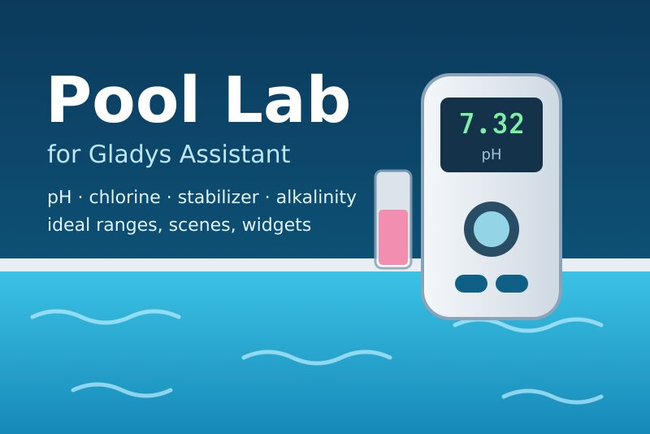
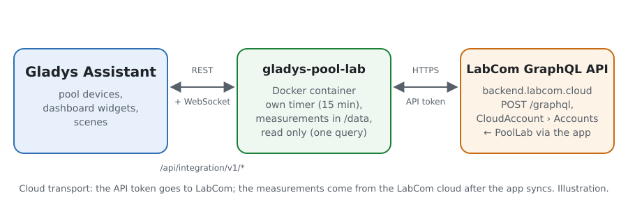
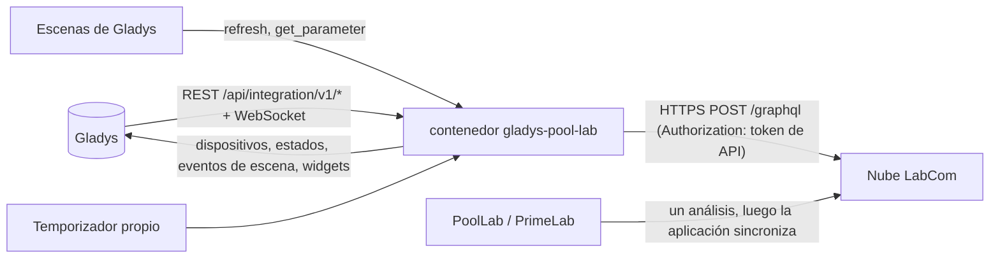
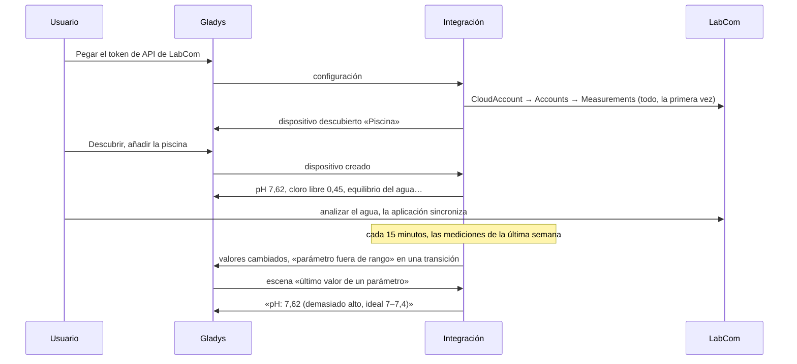
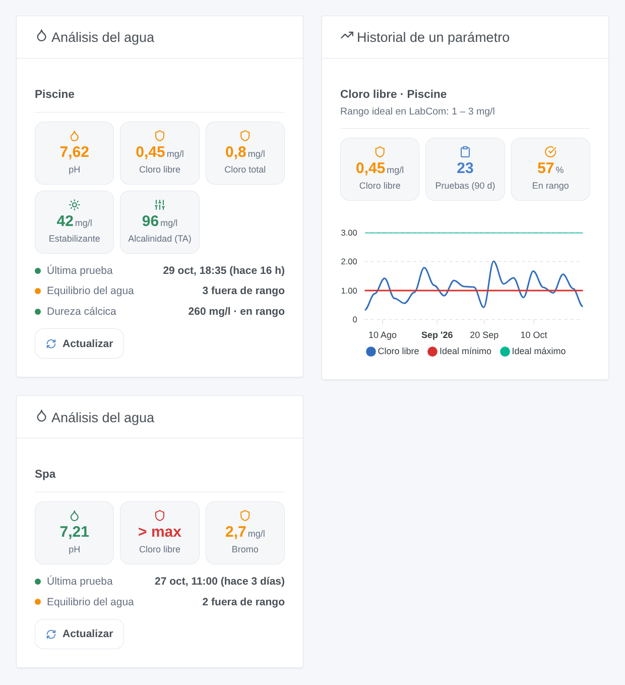

# Gladys Pool Lab

[English](README.md) · [Français](README.fr.md) · [Deutsch](README.de.md) · **Español**

[](LICENSE)
[](https://github.com/William-De71/gladys-pool-lab/releases)
[](https://github.com/William-De71/gladys-pool-lab/actions/workflows/release.yml)
[](https://gladysassistant.com)



Integración externa de [Gladys Assistant](https://gladysassistant.com) para los analizadores de agua **Water-i.d. PoolLab 1.0 / 2.0 y PrimeLab**, mediante la API oficial de la nube **LabCom** y un token de API personal. Muestra en Gladys el último análisis de cada piscina o spa (pH, cloro, estabilizante, alcalinidad, dureza…) con el rango ideal definido en LabCom, y activa escenas cuando un parámetro sale de su rango o vuelve a él, o cuando el agua lleva tiempo sin analizarse — solo lectura.

Documentación de usuario: [English](docs/en.md) · [Français](docs/fr.md) · [Deutsch](docs/de.md) · [Español](docs/es.md).

No afiliada a Water-i.d. **Nunca probada con una cuenta LabCom real**: la consulta sigue el esquema GraphQL publicado y los campos que leen los clientes de Home Assistant e ioBroker; el rechazo de un token ausente (HTTP 403, una página HTML) se comprobó en real.

## Funciones

- Cada **piscina o spa** («punto de muestreo» de LabCom) de la cuenta, encontrado por sí solo; **una petición** por lectura, cada 15 minutos por defecto.
- **Un dispositivo por piscina**: una función por parámetro medido (pH, cloro libre / total / combinado, bromo, oxígeno activo, peróxido de hidrógeno, dióxido de cloro, ozono, PHMB, ácido cianúrico, alcalinidad, dureza cálcica y total, sal, fosfatos, temperatura del agua, redox y cualquier otro), con el valor de su último análisis, más el **equilibrio del agua** (lo que está fuera de su rango ideal).
- **5 disparadores de escena** (nueva medición, parámetro fuera de rango, de vuelta en rango, análisis del agua pendiente, token rechazado), **2 acciones de escena** (actualizar ahora, último valor de un parámetro) y **2 widgets** (último análisis de una piscina, historial de un parámetro).
- **Solo lectura**: una sola consulta GraphQL, nunca una mutación; nunca se modifica nada en LabCom.
- Las mediciones siguen siendo **manuales**: la aplicación PoolLab las sincroniza con LabCom, Gladys las lee allí.
- Cuatro idiomas en todas partes: inglés, francés, alemán, español.

## Funcionamiento





De un análisis del agua a una escena:



### Transporte

`transports: ["cloud"]`: todo pasa por la nube LabCom (`backend.labcom.cloud`). **El token de API sale de su red** (solo hacia LabCom); las mediciones vienen de LabCom, donde la aplicación PoolLab las deja. `/data/pool-lab.json` (modo 0600) guarda una huella del token (nunca el token), las piscinas y hasta 300 mediciones de 400 días por parámetro, la forma fijada de cada función y lo que saben los disparadores.

## Dispositivos y funciones

| Dispositivo                           | Funciones (categoría / tipo)                                                                                                                                                                                                                                                     |
| ------------------------------------- | -------------------------------------------------------------------------------------------------------------------------------------------------------------------------------------------------------------------------------------------------------------------------------- |
| Uno por piscina o spa con un análisis | pH (`ph-sensor` / `decimal`), temperatura del agua (`temperature-sensor` / `decimal`, °C), redox (`orp-sensor` / `decimal`, mV), cualquier otro parámetro (`level-sensor` / `decimal`, ppm cuando LabCom da mg/l o ppm, si no sin unidad), equilibrio del agua (`text` / `text`) |

- Gladys no tiene categoría para el cloro, el bromo, el estabilizante, la alcalinidad ni la dureza: usan el sensor numérico simple `level-sensor` / `decimal`, como la integración Flipr para su cloro.
- Una función por **identificador de parámetro de LabCom** (`ext:pool-lab:pool:<id de la cuenta>:p<id del parámetro>`): LabCom tiene un identificador por método (pH por pastilla, por líquido…), así que una piscina analizada de las dos maneras tiene dos funciones de pH con nombres distintos.
- La categoría, la unidad y los límites de una función se fijan la primera vez que se ofrece (una unidad cambiada más tarde en LabCom nunca rompe la «Actualización» de Descubrir).
- Un valor fuera de la escala de medición del fotómetro (OVERRANGE / UNDERRANGE) no tiene número: la función conserva su último valor; el equilibrio del agua, los widgets y las escenas lo indican.
- Los valores sin cambios se reenvían cada 6 horas, para que Gladys no los muestre como caducados (una piscina se analiza una o dos veces por semana).

## Disparadores, acciones de escena y widgets



**Widgets**: Análisis del agua (los cinco primeros parámetros en mosaicos coloreados según su rango ideal, cuándo se hizo el último análisis, el equilibrio del agua, los demás parámetros, un botón Actualizar) e Historial de un parámetro (un parámetro durante 30, 90 o 365 días a la hora real de cada análisis, el ideal mínimo y máximo como dos líneas, el número de análisis, la parte en rango).

**Disparadores** (un evento por transición, nunca en la primera lectura, nunca como resultado de una acción; filtros: piscina, parámetro):

- **nueva medición**: un parámetro tiene un análisis más reciente en LabCom; variables: parámetro, valor, unidad, estado, rango ideal, hora, número de serie;
- **parámetro fuera de rango** / **de vuelta en rango**: el estado del rango ideal cambia (filtro: dirección demasiado bajo / demasiado alto); variables: las mismas y el estado anterior;
- **análisis del agua pendiente**: ninguna medición durante el plazo de la configuración (7 días por defecto), entre las 9:00 y las 21:00, una vez hasta el próximo análisis;
- **token rechazado**: LabCom rechaza el token de API — una vez por rechazo.

Los valores son funciones del dispositivo: «cloro libre por debajo de 1» es un disparador de dispositivo de Gladys.

**Acciones**:

- **actualizar ahora**: lee LabCom de inmediato (como máximo una vez por minuto); los disparadores siguen en la próxima ronda del temporizador, nunca desde la acción.
- **último valor de un parámetro**: valor, unidad, estado, rango ideal, fecha, días transcurridos y una frase, de la última lectura (sin petición).

No incluido a propósito: ninguna escritura (la API tiene mutaciones, pero Gladys solo lee), ningún consejo de dosificación (la consulta `DosageRecommendation` necesita los productos de tratamiento de la cuenta; no probada), ningún punto de muestreo compartido.

Ejemplos:

- Cuando **Pool Lab: parámetro fuera de rango** (cloro libre, demasiado bajo) → enviar «Cloro libre {{triggerEvent.data.value_text}} mg/l: añada cloro».
- Cuando **Pool Lab: análisis del agua pendiente** → enviar «Ningún análisis de la piscina desde hace {{triggerEvent.data.days_since}} días».
- Cuando **Pool Lab: nueva medición** (pH) → si el dispositivo de pH supera 7,6 → encender la bomba dosificadora de pH minus.

## Requisitos

- Gladys Assistant **5.3.0** o posterior (widgets y escenas de integraciones, palabras clave del catálogo de Gladys 5.3): las instancias más antiguas no pueden instalar la integración.
- Un PoolLab 1.0, PoolLab 2.0 o PrimeLab sincronizado con una cuenta LabCom, y un token de API personal creado en [labcom.cloud/pages/user-setting](https://labcom.cloud/pages/user-setting).
- Internet: la integración solo habla con `backend.labcom.cloud`.

### El ritmo de la API

LabCom no documenta ninguna cuota. La integración se mantiene ligera: una petición a la vez; la primera lectura obtiene todas las mediciones, luego cada lectura pide las mediciones desde una semana antes de la más reciente conocida (la aplicación puede sincronizar un análisis días después), y los últimos 400 días cada 6 horas. Tras un 429, toda petición espera su Retry-After (15 minutos sin cabecera).

## Instalación

- **Desde la tienda**: Integraciones → Pool Lab → Instalar.
- **Desde la URL del repositorio**: Integraciones → integración externa → `https://github.com/William-De71/gladys-pool-lab`.
- **Modo desarrollador**: ejecutar `npm start` con las variables que da Gladys (ver Desarrollo).

## Configuración

| Campo o botón                    | Por defecto | Significado                                                                                   |
| -------------------------------- | ----------- | --------------------------------------------------------------------------------------------- |
| Token de API de LabCom           | —           | Obligatorio, un secreto: nunca se vuelve a mostrar ni se registra; solo una huella en `/data` |
| Lectura de LabCom                | 15 min      | 5, 10, 15, 30 o 60 min                                                                        |
| Recordatorio de análisis tras    | 7 días      | 3, 7, 14 o 30 días sin análisis, o nunca                                                      |
| Idioma de los textos             | automático  | Nombres de las funciones, equilibrio del agua, textos de escenas y errores                    |
| Probar la conexión / Diagnóstico | —           | Lee LabCom y enumera las piscinas; el estado en los registros, sin el token                   |

## Uso

1. En labcom.cloud: Ajustes → crear un token de API y copiarlo.
2. En Gladys (Integraciones → Pool Lab → Configuración): pegar el token; pulsar **Probar la conexión**.
3. **Descubrir**, luego añadir las piscinas como dispositivos; añadir los widgets a un panel.
4. Crear escenas con las funciones, los disparadores y las acciones.

## Desarrollo

```bash
npm install
npm test                       # node --test, un LabCom falso (fetch en memoria), nunca la red
npm run lint                   # ESLint
npm run format:check           # Prettier
npx github:GladysAssistant/integration-store . --skip-image-check
scripts/build-cover.sh         # cover.jpg desde docs/assets/cover.svg
docs/illustrations/render.sh   # docs/assets/widgets.<idioma>.png
```

En local, el SDK lee `GLADYS_HOST_API_URL`, `GLADYS_INTEGRATION_TOKEN` y `GLADYS_INTEGRATION_SELECTOR` (que da Gladys en modo desarrollador), y la integración lee `TZ`. `DEBUG=gladys-integration-sdk` muestra los registros del SDK.

Las pruebas cubren el cliente GraphQL (el token en bruto, el 403 HTML, los errores GraphQL, el 429 y el Retry-After), el analizador (cadenas o números, OVERRANGE, todas las grafías del estado, las reglas «no definido» de LabCom), la naturaleza de los parámetros, la fusión de las lecturas, los disparadores (transiciones, mediciones tardías, recordatorio), los dispositivos (los campos que exige Descubrir, los pares categoría / tipo del SDK), los widgets (`validateWidgetContent`), el manifiesto, los cuatro idiomas, el script de publicación y la integración completa frente al Gladys falso del SDK y un LabCom falso con una cuenta inventada (`test/fixtures/cloud.json`). `test/structure.test.js` fija todas las claves que guarda el usuario.

## Proceso de publicación


Cada fusión en `main` lanza la CI y luego calcula la versión a partir de los [Conventional Commits](https://www.conventionalcommits.org/) desde la última etiqueta: `feat` → menor, `fix` / `perf` → parche, `!` o `BREAKING CHANGE` → mayor (una menor por debajo de 1.0.0); `docs`, `chore`, `ci`, `test`, `style`, `refactor`, `build` solos no publican nada. Se genera la sección del changelog, se sube la etiqueta, se construye la imagen multiarquitectura, luego `main` recibe el commit de publicación, se crea la GitHub Release y un último job comprueba la imagen pública, el validador de la tienda y el topic.

- El título de la pull request se convierte en el commit squash y luego en la línea del changelog: escríbalo en inglés, para el usuario (`pr-title.yml` lo comprueba). Nunca edite `CHANGELOG.md` a mano.
- La 1.0.0 es una decisión: Actions → Release → Run workflow con `release-as: 1.0.0`. `dry-run` muestra la versión y las notas sin publicar.
- **Rama protegida**: la publicación sube su commit a `main` con `GITHUB_TOKEN`. El ruleset `protect-main` (sin borrado ni force-push) lo deja pasar; una regla más estricta (pull request obligatoria, status checks) requeriría GitHub Actions en la lista de excepciones, o una GitHub App.
- Tras la primera publicación, haga público el paquete de `ghcr.io` (Package settings → Change visibility), o Gladys no podrá descargarlo.

## Solución de problemas

Ver [docs/es.md](docs/es.md#solución-de-problemas). Informe de los problemas con las versiones de Gladys y de la integración, su fotómetro (PoolLab 1.0, 2.0, PrimeLab), el mensaje de **Probar la conexión** y el resultado de **Diagnóstico** (en los registros de la integración). Nunca pegue su token.

## Contribuir

Las issues y pull requests son bienvenidas. Ejecute `npm run format:check && npm run lint && npm test` antes de abrir una pull request, y mantenga sin cambios todos los identificadores externos y claves guardadas (ver [CLAUDE.md](CLAUDE.md)). Una prueba con una cuenta LabCom real (las líneas de `Diagnóstico`, sin el token) sería la mayor ayuda.

## Seguridad

Ver [SECURITY.md](SECURITY.md): informe de las vulnerabilidades en privado. El token de API es un campo `secret`: nunca se registra, nunca se escribe en `/data` (solo una huella corta), se envía solo a `backend.labcom.cloud`.

## Capturas pendientes

Las imágenes de arriba son ilustraciones, no capturas de pantalla. Las capturas reales irán en `docs/assets/screenshots/` (PNG, 1280 × 800): `configuration.png`, `discovery.png` (las piscinas ofrecidas), `device.png` (una piscina con sus funciones), `scene-out-of-range.png` (una escena con el disparador «parámetro fuera de rango»), `dashboard.png` (los dos widgets con una cuenta real).

## Licencia

[Licencia Apache 2.0](LICENSE) — ver también [NOTICE](NOTICE). PoolLab, PrimeLab y LabCom son marcas de Water-i.d. GmbH. Gracias a la documentación y al SDK de Gladys, a Water-i.d. por la API pública de LabCom, y a los autores del cliente de Home Assistant python_poollab y del adaptador ioBroker.labcom.
