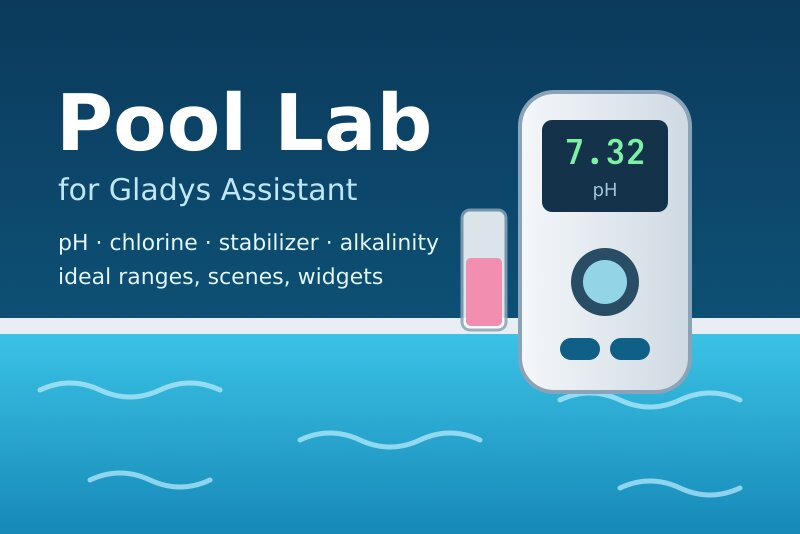
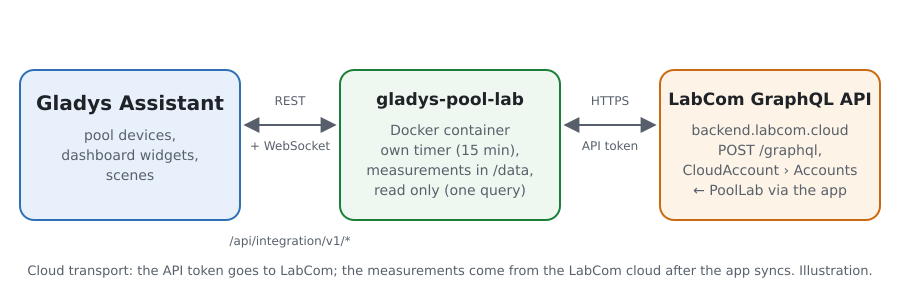
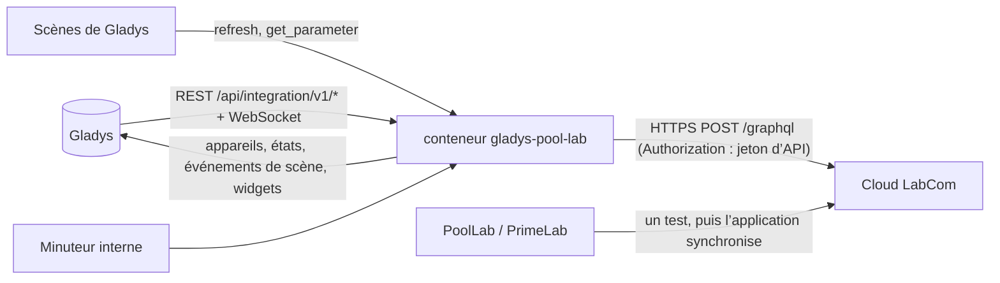
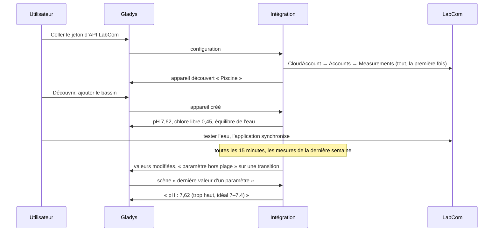
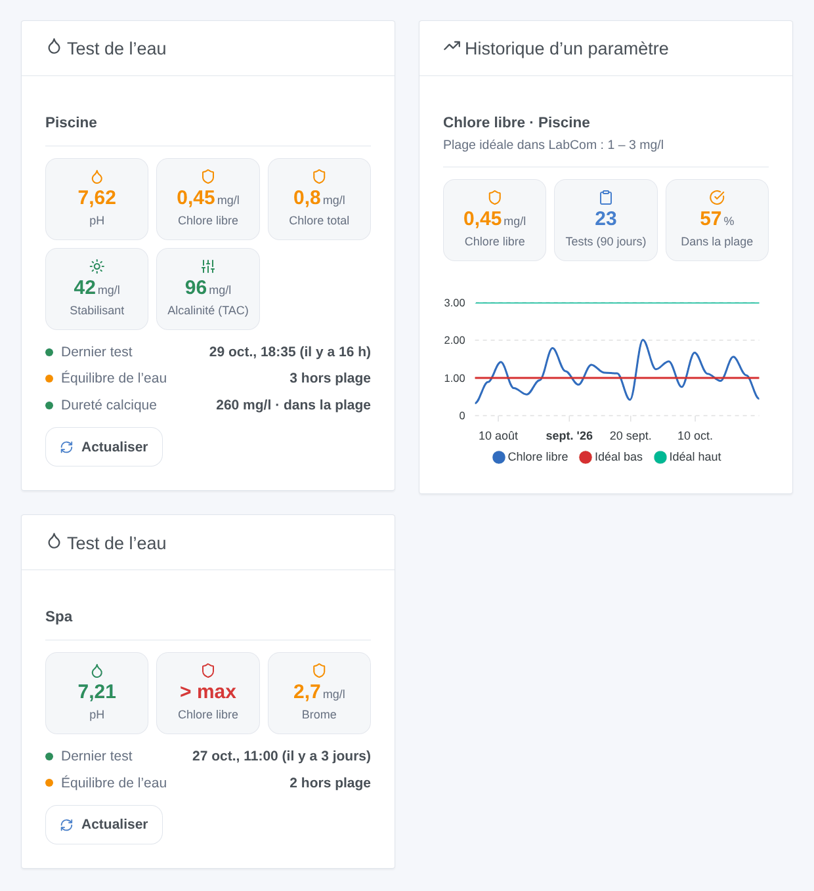

# Gladys Pool Lab

[English](README.md) · **Français** · [Deutsch](README.de.md) · [Español](README.es.md)

[](LICENSE)
[](https://github.com/William-De71/gladys-pool-lab/releases)
[](https://github.com/William-De71/gladys-pool-lab/actions/workflows/release.yml)
[](https://gladysassistant.com)



Intégration externe de [Gladys Assistant](https://gladysassistant.com) pour les analyseurs d’eau **Water-i.d. PoolLab 1.0 / 2.0 et PrimeLab**, via l’API officielle du cloud **LabCom** et un jeton d’API personnel. Elle affiche dans Gladys le dernier test de chaque piscine ou spa (pH, chlore, stabilisant, alcalinité, dureté…) avec la plage idéale définie dans LabCom, et déclenche des scènes quand un paramètre sort de sa plage ou y revient, ou quand l’eau n’a pas été testée depuis un moment — en lecture seule.

Documentation utilisateur : [English](docs/en.md) · [Français](docs/fr.md) · [Deutsch](docs/de.md) · [Español](docs/es.md).

Non affiliée à Water-i.d. **Jamais testée avec un vrai compte LabCom** : la requête suit le schéma GraphQL publié et les champs lus par les clients Home Assistant et ioBroker ; le refus d’un jeton absent (HTTP 403, une page HTML) a été vérifié en réel.

## Fonctionnalités

- Chaque **piscine ou spa** (« point de prélèvement » LabCom) du compte, trouvé tout seul ; **une seule requête** par lecture, toutes les 15 minutes par défaut.
- **Un appareil par bassin** : une fonctionnalité par paramètre mesuré (pH, chlore libre / total / combiné, brome, oxygène actif, peroxyde d’hydrogène, dioxyde de chlore, ozone, PHMB, acide cyanurique, alcalinité, dureté calcique et totale, sel, phosphates, température de l’eau, redox, et tout autre), avec la valeur de son dernier test, plus l’**équilibre de l’eau** (ce qui sort de sa plage idéale).
- **5 déclencheurs de scène** (nouvelle mesure, paramètre hors plage, retour dans la plage, test de l’eau en retard, jeton refusé), **2 actions de scène** (actualiser maintenant, dernière valeur d’un paramètre) et **2 widgets** (dernier test d’un bassin, historique d’un paramètre).
- **Lecture seule** : une seule requête GraphQL, jamais de mutation ; rien n’est jamais modifié dans LabCom.
- Les mesures restent **manuelles** : l’application PoolLab les synchronise avec LabCom, Gladys les lit là-bas.
- Quatre langues partout : anglais, français, allemand, espagnol.

## Fonctionnement





D’un test de l’eau à une scène :



### Transport

`transports: ["cloud"]` : tout passe par le cloud LabCom (`backend.labcom.cloud`). **Le jeton d’API quitte votre réseau** (vers LabCom uniquement) ; les mesures viennent de LabCom, où l’application PoolLab les dépose. `/data/pool-lab.json` (mode 0600) garde une empreinte du jeton (jamais le jeton), les bassins et jusqu’à 300 mesures sur 400 jours par paramètre, la forme figée de chaque fonctionnalité et ce que savent les déclencheurs.

## Appareils et fonctionnalités

| Appareil                            | Fonctionnalités (catégorie / type)                                                                                                                                                                                                                                                     |
| ----------------------------------- | -------------------------------------------------------------------------------------------------------------------------------------------------------------------------------------------------------------------------------------------------------------------------------------- |
| Un par piscine ou spa ayant un test | pH (`ph-sensor` / `decimal`), température de l’eau (`temperature-sensor` / `decimal`, °C), redox (`orp-sensor` / `decimal`, mV), tout autre paramètre (`level-sensor` / `decimal`, ppm quand LabCom donne des mg/l ou des ppm, sinon sans unité), équilibre de l’eau (`text` / `text`) |

- Gladys n’a pas de catégorie pour le chlore, le brome, le stabilisant, l’alcalinité ou la dureté : ils utilisent le capteur numérique simple `level-sensor` / `decimal`, comme l’intégration Flipr pour son chlore.
- Une fonctionnalité par **identifiant de paramètre LabCom** (`ext:pool-lab:pool:<id du compte>:p<id du paramètre>`) : LabCom a un identifiant par méthode (pH par pastille, par liquide…), donc un bassin testé des deux façons a deux fonctionnalités pH, nommées différemment.
- La catégorie, l’unité et les bornes d’une fonctionnalité sont figées la première fois qu’elle est proposée (une unité changée plus tard dans LabCom ne casse jamais la « Mise à jour » de la découverte).
- Une valeur hors de l’échelle de mesure du photomètre (OVERRANGE / UNDERRANGE) n’a pas de nombre : la fonctionnalité garde sa dernière valeur ; l’équilibre de l’eau, les widgets et les scènes l’indiquent.
- Les valeurs inchangées sont renvoyées toutes les 6 heures, pour que Gladys ne les affiche pas comme périmées (un bassin est testé une ou deux fois par semaine).

## Déclencheurs, actions de scène et widgets



**Widgets** : Test de l’eau (les cinq premiers paramètres en tuiles colorées selon leur plage idéale, la date du dernier test, l’équilibre de l’eau, les autres paramètres, un bouton Actualiser) et Historique d’un paramètre (un paramètre sur 30, 90 ou 365 jours à l’heure réelle de chaque test, l’idéal bas et l’idéal haut en deux lignes, le nombre de tests, la part dans la plage).

**Déclencheurs** (un événement par transition, jamais à la première lecture, jamais à la suite d’une action ; filtres : bassin, paramètre) :

- **nouvelle mesure** : un paramètre a un test plus récent dans LabCom ; variables : paramètre, valeur, unité, état, plage idéale, date, numéro de série ;
- **paramètre hors plage** / **retour dans la plage** : l’état de la plage idéale change (filtre : sens trop bas / trop haut) ; variables : les mêmes et l’état précédent ;
- **test de l’eau en retard** : aucune mesure depuis le délai de la configuration (7 jours par défaut), entre 9 h et 21 h, une fois jusqu’au prochain test ;
- **jeton refusé** : LabCom refuse le jeton d’API — une fois par refus.

Les valeurs sont des fonctionnalités d’appareil : « chlore libre inférieur à 1 » est un déclencheur d’appareil de Gladys.

**Actions** :

- **actualiser maintenant** : lit LabCom tout de suite (une fois par minute au plus) ; les déclencheurs suivent au tour suivant du minuteur, jamais depuis l’action.
- **dernière valeur d’un paramètre** : valeur, unité, état, plage idéale, date, nombre de jours écoulés et une phrase, d’après la dernière lecture (sans requête).

Volontairement absent : aucune écriture (l’API a des mutations, mais Gladys ne fait que lire), pas de conseil de dosage (la requête `DosageRecommendation` a besoin des produits de traitement du compte ; non testée), pas de points de prélèvement partagés.

Exemples :

- Quand **Pool Lab : paramètre hors plage** (chlore libre, trop bas) → envoyer « Chlore libre {{triggerEvent.data.value_text}} mg/l : ajoutez du chlore ».
- Quand **Pool Lab : test de l’eau en retard** → envoyer « Pas de test de la piscine depuis {{triggerEvent.data.days_since}} jours ».
- Quand **Pool Lab : nouvelle mesure** (pH) → si l’appareil pH dépasse 7,6 → allumer la pompe doseuse de pH moins.

## Prérequis

- Gladys Assistant **5.3.0** ou plus récent (widgets et scènes des intégrations, mots-clés du catalogue de Gladys 5.3) : les instances plus anciennes ne peuvent pas installer l’intégration.
- Un PoolLab 1.0, PoolLab 2.0 ou PrimeLab synchronisé avec un compte LabCom, et un jeton d’API personnel créé sur [labcom.cloud/pages/user-setting](https://labcom.cloud/pages/user-setting).
- Internet : l’intégration ne parle qu’à `backend.labcom.cloud`.

### Le rythme de l’API

LabCom ne documente aucun quota. L’intégration reste légère : une requête à la fois ; la première lecture récupère toutes les mesures, puis chaque lecture demande les mesures depuis une semaine avant la plus récente connue (l’application peut synchroniser un test plusieurs jours après), et les 400 derniers jours toutes les 6 heures. Après un 429, toute requête attend son Retry-After (15 minutes sans en-tête).

## Installation

- **Depuis le store** : Intégrations → Pool Lab → Installer.
- **Depuis l’URL du dépôt** : Intégrations → intégration externe → `https://github.com/William-De71/gladys-pool-lab`.
- **Mode développeur** : lancer `npm start` avec les variables fournies par Gladys (voir Développement).

## Configuration

| Champ ou bouton                  | Défaut      | Rôle                                                                                           |
| -------------------------------- | ----------- | ---------------------------------------------------------------------------------------------- |
| Jeton d’API LabCom               | —           | Obligatoire, un secret : jamais réaffiché, jamais journalisé, seule une empreinte dans `/data` |
| Lecture de LabCom                | 15 min      | 5, 10, 15, 30 ou 60 min                                                                        |
| Rappel de test après             | 7 jours     | 3, 7, 14 ou 30 jours sans test, ou jamais                                                      |
| Langue des textes                | automatique | Noms des fonctionnalités, équilibre de l’eau, textes des scènes et erreurs                     |
| Tester la connexion / Diagnostic | —           | Lit LabCom et liste les bassins ; l’état dans les journaux, sans le jeton                      |

## Utilisation

1. Sur labcom.cloud : Paramètres → créer un jeton d’API, le copier.
2. Dans Gladys (Intégrations → Pool Lab → Configuration) : coller le jeton ; appuyer sur **Tester la connexion**.
3. **Découvrir**, puis ajouter vos bassins comme appareils ; ajouter les widgets à un tableau de bord.
4. Construire des scènes avec les fonctionnalités, les déclencheurs et les actions.

## Développement

```bash
npm install
npm test                       # node --test, un faux LabCom (fetch en mémoire), jamais le réseau
npm run lint                   # ESLint
npm run format:check           # Prettier
npx github:GladysAssistant/integration-store . --skip-image-check
scripts/build-cover.sh         # cover.jpg depuis docs/assets/cover.svg
docs/illustrations/render.sh   # docs/assets/widgets.<langue>.png
```

En local, le SDK lit `GLADYS_HOST_API_URL`, `GLADYS_INTEGRATION_TOKEN` et `GLADYS_INTEGRATION_SELECTOR` (fournis par Gladys en mode développeur), et l’intégration lit `TZ`. `DEBUG=gladys-integration-sdk` affiche les journaux du SDK.

Les tests couvrent le client GraphQL (le jeton brut, le 403 HTML, les erreurs GraphQL, le 429 et le Retry-After), l’analyseur (chaînes ou nombres, OVERRANGE, toutes les graphies de l’état, les règles « non défini » de LabCom), la nature des paramètres, la fusion des lectures, les déclencheurs (transitions, mesures tardives, rappel), les appareils (les champs exigés par la découverte, les couples catégorie / type du SDK), les widgets (`validateWidgetContent`), le manifeste, les quatre langues, le script de release, et l’intégration complète face au faux Gladys du SDK et à un faux LabCom sur un compte inventé (`test/fixtures/cloud.json`). `test/structure.test.js` fige toutes les clés stockées chez l’utilisateur.

## Processus de release


Chaque fusion sur `main` lance la CI, puis calcule la version à partir des [Conventional Commits](https://www.conventionalcommits.org/) depuis le dernier tag : `feat` → mineure, `fix` / `perf` → correctif, `!` ou `BREAKING CHANGE` → majeure (une mineure sous 1.0.0) ; `docs`, `chore`, `ci`, `test`, `style`, `refactor`, `build` seuls ne publient rien. La section du changelog est générée, le tag poussé, l’image multi-architecture construite, puis `main` reçoit le commit de release, la GitHub Release est créée et un dernier job vérifie l’image publique, le validateur du store et le topic.

- Le titre de la pull request devient le commit squash, puis la ligne du changelog : écrivez-le en anglais, pour l’utilisateur (`pr-title.yml` le vérifie). Ne modifiez jamais `CHANGELOG.md` à la main.
- La 1.0.0 est une décision : Actions → Release → Run workflow avec `release-as: 1.0.0`. `dry-run` montre la version et les notes sans rien publier.
- **Branche protégée** : la release pousse son commit sur `main` avec `GITHUB_TOKEN`. Le ruleset `protect-main` (ni suppression ni force-push) le laisse passer ; une règle plus stricte (pull request obligatoire, status checks) demanderait d’ajouter GitHub Actions aux contournements, ou une GitHub App.
- Après la première release, rendez public le package `ghcr.io` (Package settings → Change visibility), sinon Gladys ne peut pas le télécharger.

## Dépannage

Voir [docs/fr.md](docs/fr.md#dépannage). Signalez les problèmes avec les versions de Gladys et de l’intégration, votre photomètre (PoolLab 1.0, 2.0, PrimeLab), le message de **Tester la connexion** et le résultat de **Diagnostic** (dans les journaux de l’intégration). Ne collez jamais votre jeton.

## Contribuer

Les issues et pull requests sont les bienvenues. Lancez `npm run format:check && npm run lint && npm test` avant d’ouvrir une pull request, et gardez inchangés tous les identifiants externes et clés stockées (voir [CLAUDE.md](CLAUDE.md)). Un test avec un vrai compte LabCom (les lignes de `Diagnostic`, sans le jeton) aiderait beaucoup.

## Sécurité

Voir [SECURITY.md](SECURITY.md) : signalez les vulnérabilités en privé. Le jeton d’API est un champ `secret` : jamais journalisé, jamais écrit dans `/data` (seulement une courte empreinte), envoyé uniquement à `backend.labcom.cloud`.

## Captures à venir

Les images ci-dessus sont des illustrations, pas des captures d’écran. Les vraies captures iront dans `docs/assets/screenshots/` (PNG, 1280 × 800) : `configuration.png`, `discovery.png` (les bassins proposés), `device.png` (un bassin et ses fonctionnalités), `scene-out-of-range.png` (une scène sur le déclencheur « paramètre hors plage »), `dashboard.png` (les deux widgets avec un vrai compte).

## Licence

[Licence Apache 2.0](LICENSE) — voir aussi [NOTICE](NOTICE). PoolLab, PrimeLab et LabCom sont des marques de Water-i.d. GmbH. Merci à la documentation et au SDK de Gladys, à Water-i.d. pour l’API publique de LabCom, et aux auteurs du client Home Assistant python_poollab et de l’adaptateur ioBroker.labcom.
