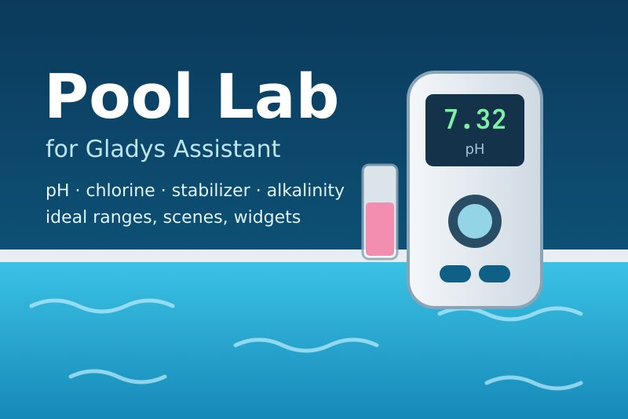
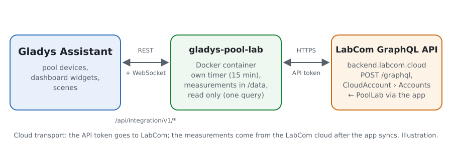
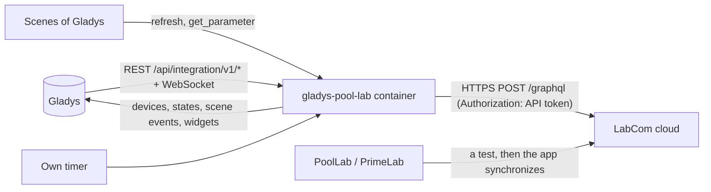
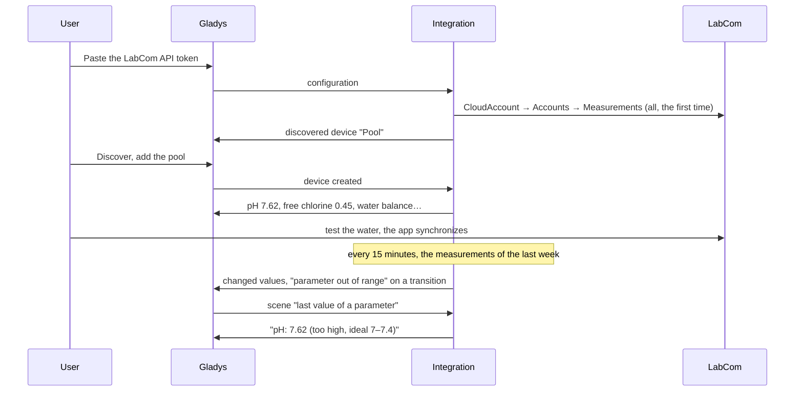
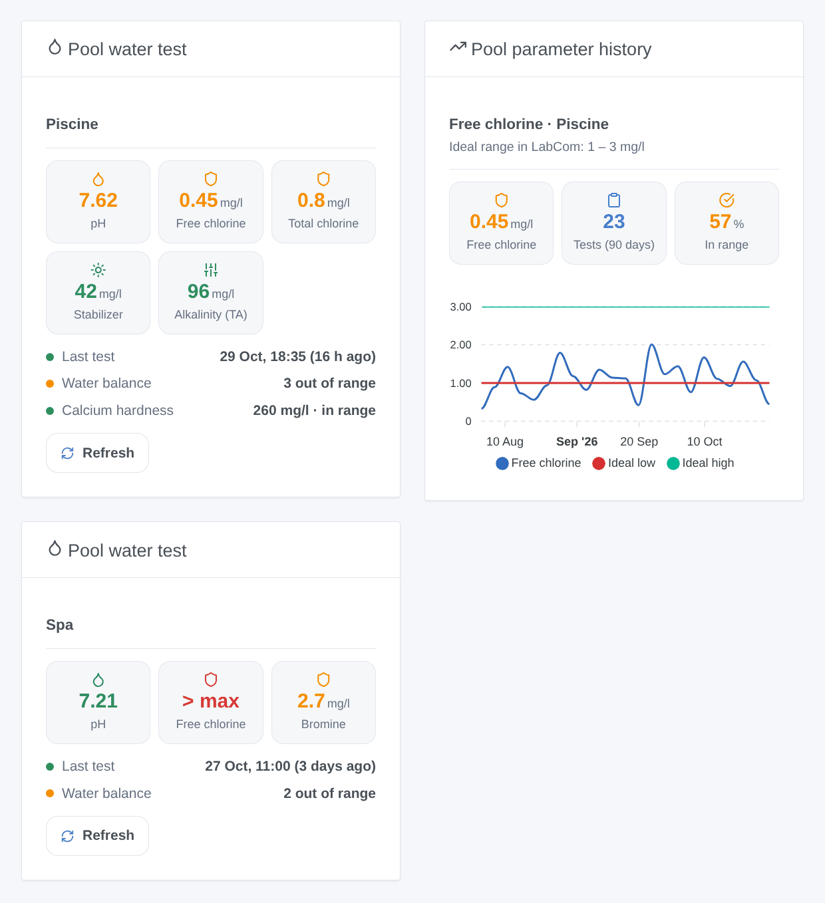

# Gladys Pool Lab

**English** · [Français](README.fr.md) · [Deutsch](README.de.md) · [Español](README.es.md)

[](LICENSE)
[](https://github.com/William-De71/gladys-pool-lab/releases)
[](https://github.com/William-De71/gladys-pool-lab/actions/workflows/release.yml)
[](https://gladysassistant.com)



[Gladys Assistant](https://gladysassistant.com) external integration for the **Water-i.d. PoolLab 1.0 / 2.0 and PrimeLab** water testers, through the official API of the **LabCom** cloud and a personal API token. It shows the last test of each pool or spa in Gladys (pH, chlorine, stabilizer, alkalinity, hardness…) with the ideal range you set in LabCom, and fires scenes when a parameter leaves or comes back to its range, or when the water has not been tested for a while — read only.

User documentation: [English](docs/en.md) · [Français](docs/fr.md) · [Deutsch](docs/de.md) · [Español](docs/es.md).

Not affiliated with Water-i.d. **Never tested with a real LabCom account**: the query follows the published GraphQL schema and the fields the Home Assistant and ioBroker clients read; the refusal of a missing token (HTTP 403, an HTML page) was checked live.

## Features

- Every **pool or spa** (LabCom "sampling point") of the account, found by itself; **one request** per reading, every 15 minutes by default.
- **One device per pool**: one feature per parameter measured (pH, free / total / combined chlorine, bromine, active oxygen, hydrogen peroxide, chlorine dioxide, ozone, PHMB, cyanuric acid, alkalinity, calcium and total hardness, salt, phosphate, water temperature, redox, and any other), with the value of its last test, plus the **water balance** (what is out of its ideal range).
- **5 scene triggers** (new measurement, parameter out of range, back in range, water test overdue, token refused), **2 scene actions** (refresh now, last value of a parameter) and **2 dashboard widgets** (last test of a pool, history of a parameter).
- **Read only**: a single GraphQL query, never a mutation; nothing is ever changed in LabCom.
- The measurements stay **manual**: the PoolLab app synchronizes them with LabCom, Gladys reads them there.
- Four languages everywhere: English, French, German, Spanish.

## How it works





From a water test to a scene:



### Transport

`transports: ["cloud"]`: everything goes through the LabCom cloud (`backend.labcom.cloud`). **The API token leaves your network** (to LabCom only); the measurements come from LabCom, where the PoolLab app puts them. `/data/pool-lab.json` (mode 0600) keeps a fingerprint of the token (never the token), the pools and up to 300 measurements of 400 days per parameter, the frozen shape of each feature and what the triggers know.

## Devices and features

| Device                          | Features (category / type)                                                                                                                                                                                                                                         |
| ------------------------------- | ------------------------------------------------------------------------------------------------------------------------------------------------------------------------------------------------------------------------------------------------------------------ |
| One per pool or spa with a test | pH (`ph-sensor` / `decimal`), water temperature (`temperature-sensor` / `decimal`, °C), redox (`orp-sensor` / `decimal`, mV), every other parameter (`level-sensor` / `decimal`, ppm when LabCom gives mg/l or ppm, else no unit), water balance (`text` / `text`) |

- Gladys has no category for chlorine, bromine, stabilizer, alkalinity or hardness: they use the plain numeric sensor `level-sensor` / `decimal`, as the Flipr integration does for its chlorine.
- One feature per **LabCom parameter id** (`ext:pool-lab:pool:<account id>:p<parameter id>`): LabCom has one id per method (pH by tablet, by liquid…), so a pool tested both ways has two pH features, named apart.
- The category, unit and bounds of a feature are frozen the first time it is offered (a unit changed later in LabCom never breaks the "Update" of Discovery).
- A value beyond the measuring range of the photometer (OVERRANGE / UNDERRANGE) has no number: the feature keeps its last value; the water balance, the widgets and the scenes say it.
- Unchanged values are sent again every 6 hours, so that Gladys does not show them as outdated (a pool is tested once or twice a week).

## Scene triggers, actions and widgets



**Widgets**: Pool water test (the first five parameters as tiles colored by their ideal range, when the last test was taken, the water balance, the other parameters, a Refresh button) and Pool parameter history (one parameter over 30, 90 or 365 days at the real time of each test, the ideal low and high as two lines, the number of tests, the share in range).

**Triggers** (one event per transition, never at the first reading, never as the result of an action; filters: pool, parameter):

- **new measurement**: a parameter has a newer test in LabCom; variables: parameter, value, unit, status, ideal range, time, serial number;
- **parameter out of range** / **back in range**: the ideal range status changes (filter: direction too low / too high); variables: the same and the previous status;
- **water test overdue**: no measurement for the delay of the configuration (7 days by default), between 9:00 and 21:00, once until the next test;
- **token refused**: LabCom refuses the API token — once per refusal.

The values are device features: "free chlorine under 1" is a device trigger of Gladys.

**Actions**:

- **refresh now**: reads LabCom now (once a minute at most); the triggers follow at the next round of the timer, never from the action.
- **last value of a parameter**: value, unit, status, ideal range, date, days since and a sentence, from the last reading (no request).

Not done, on purpose: no write (the API has mutations, but Gladys only reads), no dosage advice (the `DosageRecommendation` query needs the water treatment products of the account; not tested), no shared sampling points.

Examples:

- When **Pool Lab: parameter out of range** (free chlorine, too low) → send "Free chlorine {{triggerEvent.data.value_text}} mg/l: add chlorine".
- When **Pool Lab: water test overdue** → send "No pool test for {{triggerEvent.data.days_since}} days".
- When **Pool Lab: new measurement** (pH) → if the pH device is above 7.6 → turn on the pH-minus dosing pump.

## Requirements

- Gladys Assistant **5.3.0** or later (widgets and scenes of integrations, catalog keywords of Gladys 5.3): older instances cannot install the integration.
- A PoolLab 1.0, PoolLab 2.0 or PrimeLab synchronized with a LabCom account, and a personal API token created on [labcom.cloud/pages/user-setting](https://labcom.cloud/pages/user-setting).
- The internet: the integration talks to `backend.labcom.cloud` only.

### The pace of the API

LabCom documents no quota. The integration stays light: one request at a time; the first reading takes every measurement, then each reading asks for the measurements since a week before the newest one known (the app may synchronize a test days later), and the last 400 days every 6 hours. After a 429 every request waits for its Retry-After (15 minutes without one).

## Installation

- **From the store**: Integrations → Pool Lab → Install.
- **From the repository URL**: Integrations → external integration → `https://github.com/William-De71/gladys-pool-lab`.
- **Developer mode**: run `npm start` with the variables given by Gladys (see Development).

## Configuration

| Field or button                  | Default   | Meaning                                                                            |
| -------------------------------- | --------- | ---------------------------------------------------------------------------------- |
| LabCom API token                 | —         | Required, a secret: never shown again, never logged, only a fingerprint in `/data` |
| Reading of LabCom                | 15 min    | 5, 10, 15, 30 or 60 min                                                            |
| Test reminder after              | 7 days    | 3, 7, 14 or 30 days without a test, or never                                       |
| Language of the texts            | automatic | Feature names, water balance, scene texts and errors                               |
| Test the connection / Diagnostic | —         | Reads LabCom and lists the pools; the state in the logs, without the token         |

## Usage

1. On labcom.cloud: Settings → create an API token, copy it.
2. In Gladys (Integrations → Pool Lab → Configuration): paste the token; press **Test the connection**.
3. **Discover**, then add your pools as devices; add the widgets to a dashboard.
4. Build scenes with the features, the triggers and the actions.

## Development

```bash
npm install
npm test                       # node --test, a fake LabCom (in-memory fetch), never the network
npm run lint                   # ESLint
npm run format:check           # Prettier
npx github:GladysAssistant/integration-store . --skip-image-check
scripts/build-cover.sh         # cover.jpg from docs/assets/cover.svg
docs/illustrations/render.sh   # docs/assets/widgets.<lang>.png
```

Locally, the SDK reads `GLADYS_HOST_API_URL`, `GLADYS_INTEGRATION_TOKEN` and `GLADYS_INTEGRATION_SELECTOR` (given by Gladys in developer mode), and the integration reads `TZ`. `DEBUG=gladys-integration-sdk` shows the SDK logs.

The tests cover the GraphQL client (the raw token, the HTML 403, GraphQL errors, 429 and Retry-After), the parser (strings or numbers, OVERRANGE, every spelling of the status, the "not set" rules of LabCom), the kinds of parameters, the merge of the readings, the triggers (transitions, late measurements, reminder), the devices (the fields the Discovery screen requires, the category / type pairs of the SDK), the widgets (`validateWidgetContent`), the manifest, the four languages, the release script, and the whole integration against the fake Gladys of the SDK and a fake LabCom on a made-up account (`test/fixtures/cloud.json`). `test/structure.test.js` freezes every key users store.

## Release process


Every merge on `main` runs the CI, then computes the version from the [Conventional Commits](https://www.conventionalcommits.org/) since the last tag: `feat` → minor, `fix` / `perf` → patch, `!` or `BREAKING CHANGE` → major (a minor below 1.0.0); `docs`, `chore`, `ci`, `test`, `style`, `refactor`, `build` alone publish nothing. The changelog section is generated, the tag pushed, the multi-architecture image built, then `main` receives the release commit, the GitHub Release is created and a last job checks the public image, the store validator and the topic.

- The pull request title becomes the squash commit, then the changelog line: write it in English, for the user (`pr-title.yml` checks it). Never edit `CHANGELOG.md` by hand.
- 1.0.0 is a decision: Actions → Release → Run workflow with `release-as: 1.0.0`. `dry-run` shows the version and the notes without publishing.
- **Protected branch**: the release pushes its commit to `main` with `GITHUB_TOKEN`. The `protect-main` ruleset (no deletion, no force-push) lets it through; a stricter rule (pull request required, status checks) would need GitHub Actions in its bypass list, or a GitHub App.
- After the first release, make the `ghcr.io` package public (Package settings → Change visibility), or Gladys cannot pull it.

## Troubleshooting

See [docs/en.md](docs/en.md#troubleshooting). Report issues with the versions of Gladys and of the integration, your photometer (PoolLab 1.0, 2.0, PrimeLab), the message of **Test the connection** and the result of **Diagnostic** (in the logs of the integration). Never paste your token.

## Contributing

Issues and pull requests are welcome. Run `npm run format:check && npm run lint && npm test` before opening a pull request, and keep every external id and stored key unchanged (see [CLAUDE.md](CLAUDE.md)). A test with a real LabCom account (the `Diagnostic` lines, without the token) would help most.

## Security

See [SECURITY.md](SECURITY.md): report vulnerabilities privately. The API token is a `secret` field: never logged, never written to `/data` (only a short fingerprint), sent to `backend.labcom.cloud` only.

## Screenshots to come

The images above are illustrations, not screenshots. Real screenshots will go in `docs/assets/screenshots/` (PNG, 1280 × 800): `configuration.png`, `discovery.png` (the pools offered), `device.png` (a pool with its features), `scene-out-of-range.png` (a scene on the "parameter out of range" trigger), `dashboard.png` (the two widgets with a real account).

## License

[Apache License 2.0](LICENSE) — see also [NOTICE](NOTICE). PoolLab, PrimeLab and LabCom are trademarks of Water-i.d. GmbH. Thanks to the Gladys documentation and SDK, to Water-i.d. for the public LabCom API, and to the authors of the Home Assistant client python_poollab and of the ioBroker.labcom adapter.
