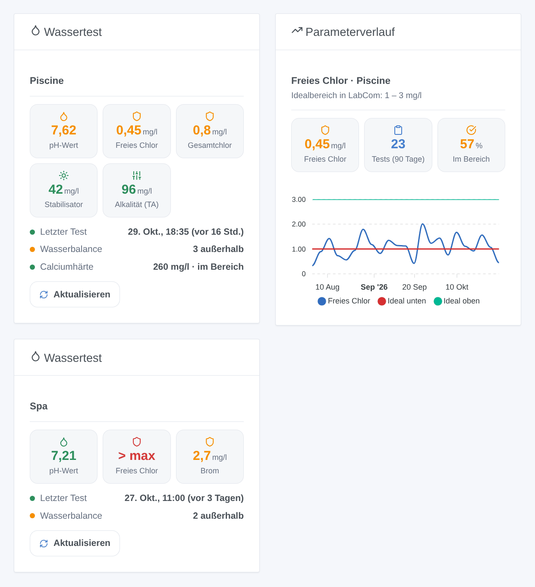

# Pool Lab

## Überblick

Diese Integration bringt die Wassertests deines Photometers **Water-i.d. PoolLab 1.0 / 2.0** oder **PrimeLab** in Gladys: pH-Wert, Chlor, Cyanursäure, Alkalität, Härte und die anderen Parameter, die du misst, mit dem Idealbereich, den du in LabCom für jeden festgelegt hast. Sie liest die **LabCom-Cloud** über deren offizielle GraphQL-API mit einem persönlichen API-Token. Sie liest nur und ist nicht mit Water-i.d. verbunden.

- Ein Gerät pro LabCom-„Messstelle“ (ein Pool, ein Spa): eine Funktion pro gemessenem Parameter mit dem Wert seines letzten Tests, und die Wasserbalance (was außerhalb seines Idealbereichs liegt).
- Zwei Dashboard-Widgets: der letzte Test eines Beckens, nach Idealbereich gefärbt; der Verlauf eines Parameters mit seinem Idealbereich.
- Szenen-Auslöser: neue Messung, Parameter außerhalb seines Idealbereichs, wieder im Bereich, Wassertest überfällig, Token abgelehnt.
- Szenen-Aktionen: jetzt aktualisieren, letzter Wert eines Parameters.

Die Messungen bleiben **manuell**: Du testest das Wasser mit dem Photometer, die PoolLab-App synchronisiert das Ergebnis mit LabCom, und Gladys liest es dort. Gladys misst nie selbst.

Transport: Cloud. Das API-Token geht an LabCom (`backend.labcom.cloud`); die Messungen kommen aus der LabCom-Cloud.

## Voraussetzungen

- Gladys Assistant 5.3.0 oder neuer.
- Ein PoolLab 1.0, PoolLab 2.0 oder PrimeLab und ein LabCom-Konto, mit dem die App ihre Messungen synchronisiert (prüfe sie auf [labcom.cloud](https://labcom.cloud/)).
- Ein persönliches **API-Token**: Melde dich bei [labcom.cloud](https://labcom.cloud/) an, öffne die **Einstellungen** ([labcom.cloud/pages/user-setting](https://labcom.cloud/pages/user-setting)), erstelle ein API-Token und kopiere es. Halte es geheim: Wer es besitzt, kann deine Messungen lesen.
- Optional, aber nützlich: der Idealbereich jedes Parameters in LabCom (unterer und oberer Wert). Ohne ihn wird ein Parameter „ohne Idealbereich“ angezeigt und löst nie die Bereichs-Auslöser aus.

## Konfiguration

| Feld                 | Bedeutung                                                                                                                          |
| -------------------- | ---------------------------------------------------------------------------------------------------------------------------------- |
| LabCom-API-Token     | Das auf labcom.cloud erstellte Token (geheim: nie wieder angezeigt, nie in die Logs geschrieben; nur ein Fingerabdruck in `/data`) |
| Abfrage von LabCom   | Alle 5, 10, 15 (Standard), 30 oder 60 Minuten: wie lange es nach einer Synchronisierung dauert, bis Gladys einen neuen Test sieht  |
| Test-Erinnerung nach | 3, 7 (Standard), 14 oder 30 Tage ohne neue Messung bis zum Auslöser „Wassertest überfällig“; oder nie                              |
| Sprache der Texte    | Namen der Funktionen, Wasserbalance, Szenentexte und Fehler; automatisch folgt dem letzten Widget                                  |

Schaltflächen:

- **Verbindung testen** liest LabCom mit dem Token und listet die Becken auf (und wie viele Messungen haben).
- **Diagnose** schreibt den Zustand der Integration in ihre Logs, ohne das Token.

Die erste Abfrage holt alle Messungen des Kontos; danach fragt jede Abfrage nur die Messungen der letzten Woche ab, und die letzten 400 Tage werden alle 6 Stunden neu gelesen (eine in LabCom geänderte oder gelöschte Messung wird übernommen). Die Integration behält bis zu 300 Messungen aus 400 Tagen pro Parameter in `/data`.

## Verwendung

### Geräte

Öffne nach der Konfiguration **Entdecken**: Jeder Pool oder Spa mit mindestens einer Messung wird als Gerät angeboten, benannt nach seiner Bezeichnung in LabCom. Füge die gewünschten hinzu. Ein später gemessener Parameter fügt eine Funktion hinzu: Entdecken bietet dann an, das Gerät zu aktualisieren.

| Parameter                                                                                                                                      | Kategorie / Typ                  | Einheit                        |
| ---------------------------------------------------------------------------------------------------------------------------------------------- | -------------------------------- | ------------------------------ |
| pH-Wert                                                                                                                                        | `ph-sensor` / `decimal`          | pH                             |
| Freies, Gesamt- und gebundenes Chlor, Brom, Aktivsauerstoff, Wasserstoffperoxid, Chlordioxid, Ozon, PHMB, Cyanursäure, Alkalität, Härte, Salz… | `level-sensor` / `decimal`       | ppm (mg/l) oder keine          |
| Wassertemperatur                                                                                                                               | `temperature-sensor` / `decimal` | °C (°F, wenn LabCom es angibt) |
| Redox (ORP)                                                                                                                                    | `orp-sensor` / `decimal`         | mV                             |
| Wasserbalance                                                                                                                                  | `text` / `text`                  | —                              |

Gladys hat keine Kategorie für Chlor oder Alkalität: Sie verwenden den einfachen Zahlensensor `level-sensor` / `decimal` (wie die Flipr-Integration). Ein Wert außerhalb des Messbereichs des Photometers (OVERRANGE, UNDERRANGE) hat keine Zahl: Die Funktion behält ihren letzten Wert, Wasserbalance und Widgets zeigen es an.

### Dashboard-Widgets

- **Wassertest**: ein Becken (in den Einstellungen des Widgets wählen; standardmäßig das erste): die ersten fünf Parameter als Kacheln, grün im Bereich, orange außerhalb, rot außerhalb des Messbereichs, grau ohne Bereich; wann der letzte Test gemacht wurde, die Wasserbalance und die anderen Parameter. Die Schaltfläche **Aktualisieren** liest LabCom sofort (höchstens einmal pro Minute).
- **Parameterverlauf**: ein Parameter eines Beckens über 30, 90 oder 365 Tage, zum tatsächlichen Zeitpunkt jedes Tests (nicht dem Empfang durch Gladys), mit dem unteren und oberen Idealwert als zwei Linien, der Anzahl der Tests und dem Anteil im Bereich.

### Szenen

Auslöser (einmal pro Änderung, nie bei der ersten Abfrage, nie wegen einer Szenen-Aktion), filterbar nach Becken und Parameter:

- **Neue Messung**: Ein Parameter hat einen neueren Test in LabCom (ein Ereignis pro getestetem Parameter).
- **Parameter außerhalb**: Ein Parameter wird zu niedrig oder zu hoch für seinen Idealbereich (Filter: Richtung).
- **Wieder im Bereich**: Ein Parameter, der außerhalb lag, ist wieder im Bereich.
- **Wassertest überfällig**: keine Messung an einem Becken seit der eingestellten Frist, einmal, zwischen 9 und 21 Uhr.
- **Token abgelehnt**: LabCom lehnt das API-Token ab.

Aktionen:

- **Jetzt aktualisieren**: liest LabCom (höchstens einmal pro Minute); gibt die Anzahl der Becken, der Parameter außerhalb des Bereichs und den Zeitpunkt des letzten Tests zurück.
- **Letzter Wert eines Parameters**: Wert, Einheit, Status, Idealbereich, Datum und ein Satz, aus der letzten Abfrage.

Beispiele:

- Wenn **Pool Lab: Parameter außerhalb** (freies Chlor, zu niedrig) → „Freies Chlor {{triggerEvent.data.value_text}} mg/l, ideal ab {{triggerEvent.data.ideal_low}}: Chlor nachdosieren“ senden.
- Wenn **Pool Lab: Wassertest überfällig** → „Seit {{triggerEvent.data.days_since}} Tagen kein Pooltest“ senden.
- Jeden Samstag um 10 Uhr → **Pool Lab: letzter Wert eines Parameters** (pH-Wert) → die Zusammenfassung senden.

## Fehlerbehebung

- **„LabCom lehnt das API-Token ab“**: Das Token wurde gelöscht oder falsch kopiert; erstelle auf labcom.cloud (Einstellungen) ein neues und füge es in der Konfiguration ein.
- **Kein Gerät angeboten**: Nur Becken mit mindestens einer Messung werden angeboten; drücke **Verbindung testen** und prüfe auf labcom.cloud, ob die App synchronisiert hat.
- **Ein Test erscheint nicht**: Die App muss ihn zuerst mit LabCom synchronisieren; danach erscheint er bei der nächsten Abfrage (standardmäßig 15 Minuten) oder mit **Aktualisieren**.
- **„Kein Idealbereich“**: Lege den unteren und oberen Idealwert des Parameters in LabCom fest.
- Für ein Issue: Versionen von Gladys und der Integration, die Meldung von **Verbindung testen** und die Zeilen „Pool Lab diagnostic“, die **Diagnose** in die Logs der Integration schreibt. Füge nie dein Token ein.

### Bekannte Einschränkungen

- **Nie mit einem echten LabCom-Konto getestet**: Die Integration folgt dem veröffentlichten GraphQL-Schema und den zwei Open-Source-Clients (Home Assistant, ioBroker). Die genaue Schreibweise des Idealbereich-Status ist unbekannt: Er wird in jeder Form gelesen und aus dem Idealbereich berechnet, wenn er fehlt.
- Geteilte Messstellen (von einem anderen LabCom-Benutzer) und Wasserpflegeprodukte werden nicht gelesen.
- Die Art eines Parameters (pH-Wert, freies Chlor…) ergibt sich aus seiner LabCom-ID oder seinem Namen: Ein unbekannter Parameter behält seinen LabCom-Namen und die einfache Zahlenkategorie.
